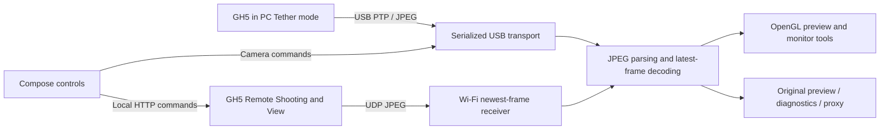

# GH5 Monitor

**An Android field monitor and remote control for the Panasonic Lumix GH5, with USB and experimental Wi-Fi connections.**

[](#compatibility)
[](LICENSE)
[](https://github.com/s1lax/gh5-monitor/actions/workflows/android.yml)

[Download APK](https://github.com/s1lax/gh5-monitor/releases/tag/v0.5.3) · [User guide](docs/USAGE.md) · [Compatibility & known issues](docs/COMPATIBILITY.md) · [Changelog](CHANGELOG.md)

Connect your GH5 to an Android phone with a USB data cable, select **PC(Tether)** on the camera, and use the phone as a larger monitor. No HDMI capture card, root access, or Wi-Fi camera connection is required.

Created and tested by **[s1lax](https://github.com/s1lax)**, developed with **GPT / OpenAI Codex**. This is a GH5-focused fork of [Lumix Monitor by velkilllmer](https://github.com/velkilllmer/lumix-USB-tether-monitor-android), with the original attribution and MIT license preserved.

> **Experimental, first public preview: 0.5.3-gh5.** The app has been tested with one GH5 and one phone, not a broad compatibility matrix. The current in-app labels are Russian; this repository's documentation is in English. Contributions for English UI localization are welcome.

The `feature/wifi-monitor` branch adds **0.6.0-gh5** Wi-Fi support using local camera HTTP commands and UDP JPEG preview. The published 0.5.3 release remains USB-only. Wi-Fi hardware validation is in progress; see the [Wi-Fi guide](docs/WIFI.md) for setup, scope and latency limits.

## What it can do

| Area | Features |
| --- | --- |
| USB live view | Camera-advertised quality selection, JPEG preview, recovery after temporary interruptions, performance diagnostics |
| Wi-Fi preview (0.6.0 branch) | Direct camera hotspot or a shared LAN, local-IP entry / SSDP discovery, newest-frame UDP decoding, basic remote controls and camera-advertised setting choices |
| Field monitor UI | Portrait and landscape layouts, large centered shutter control, clean view, independent tools that can be enabled together |
| Focus | **Camera-native MF Assist**, remembered phone-selected area, navigator, hold-to-repeat movement and ±1× magnification; separate 1:1 display inspection and app focus peaking |
| Exposure tools | Zebra, false color, histogram / RGB histogram, waveform and vectorscope, calculated from the USB preview |
| Framing | Rule of thirds, center marker, aspect guides, safe area, camera level, image rotation and anamorphic desqueeze |
| Viewing | Import `.cube` 3D LUTs, adjustable LUT strength, display-only EV / gamma / contrast correction |
| Camera control | ISO, shutter, aperture, exposure compensation and WB through scrolling value selectors; AF, shutter, video REC / STOP, supported profile and video settings |
| Camera status | Battery, recording state and timer, available exposure / AF / remaining-capacity data |
| Files | Save the original USB preview JPEG; record a silent MP4 preview on the phone; browse recent camera stills and transfer original JPEG / RW2 files where supported |
| Diagnosis | Capture matched photo/video preview stages with read-only camera parameters and export JPEG + PNG + JSON as a ZIP |
| Demo | Local moving test scene without a camera |

Feature availability depends on camera state, lens, firmware and the values reported by the camera. A visible control is not a claim that every setting or format has been verified on hardware. See the [validation details](docs/VALIDATION.md).

## Install and connect

1. Download `GH5-Monitor-0.5.3.apk` from [Releases](https://github.com/s1lax/gh5-monitor/releases/tag/v0.5.3) and install it on Android.
2. Connect the GH5 using a USB data cable / OTG connection. Enable OTG on your phone if required.
3. Choose **PC(Tether)** on the GH5 and allow Android USB access.
4. Open **GH5 Monitor**. If necessary, press **Подключить** (Connect).

The published APK is an **experimental debug-signed build**, the same tested 0.5.3 build used during development. Its SHA-256 is in the release's `SHA256SUMS.txt`. Independently built APKs normally use a different debug key and may not install over it. No private signing key is included in this repository.

The debug build contains optional phone-camera diagnostic helpers and declares Android's CAMERA permission. They are not required for GH5 monitoring. Version 0.6.0 adds network permissions for local Wi-Fi camera communication; the app has no built-in cloud upload or analytics. See [privacy and diagnostics](docs/PRIVACY.md).

## Compatibility

**Hardware tested:** Panasonic **DC-GH5, firmware 2.6**, with a **OnePlus 8 Pro, Android 13**. The project targets Android 8.0+ with USB Host / OTG support; saving originals and exporting the comparison ZIP require Android 10+.

On the tested GH5, a selected `1280×960 @ 30 fps` live-view mode produced **1280×720 JPEGs** in the tested video configuration. Sustained preview was around **30 fps** after the USB stall fix. This is compressed tether preview: **4K USB live view is not implemented**, and a higher-resolution phone screen does not add source detail. End-to-end camera-to-display latency has not been measured.

Other Lumix models, including the upstream project's S5 target, have **not** been validated with this GH5 fork. Please report your exact camera / firmware / phone combination rather than assuming compatibility.

## Known limitations

- Phone and GH5 LCD brightness can differ, particularly between photo and video modes. **The cause is unresolved.** Version 0.5.3 adds controlled comparison captures, not an automatic exposure or gamma fix. Scopes describe the received JPEG, not RAW exposure or guaranteed calibrated IRE.
- Native MF Assist moves and magnifies the camera image before USB transmission. Its navigator shows the **last area requested by the phone**; physical GH5 joystick movements and the camera's remembered position are not read back.
- Tap AF, motorized MF hold/release, RW2 transfer and the full set of video/profile settings still need broader hardware validation. JPEG original transfer and REC / STOP were checked on the development setup.
- Backgrounding the app can interrupt USB. Recovery handles many temporary failures, but some sessions still require unplugging and reconnecting the camera. Camera hangs requiring a power cycle were reported during development; this has not been proven impossible in all states.
- App overlays can coexist with any overlays already present in the received preview. Camera-side peaking / zebra availability should be checked on the actual camera and mode.
- Phone MP4 recording is a preview proxy with no audio, not the GH5's internal recording or a 4K capture.

## Build from source

Use **JDK 17**, Android SDK **platform 34** and **build-tools 34.0.0**. Gradle 8.7, AGP 8.5.2 and Kotlin 2.0.21 are pinned by the project. Android Studio can open this repository directly.

```sh
git clone https://github.com/s1lax/gh5-monitor.git
cd gh5-monitor
# Set ANDROID_HOME, or create an untracked local.properties with sdk.dir=...
./gradlew testDebugUnitTest assembleDebug
```

On Windows, use `./gradlew.bat testDebugUnitTest assembleDebug` in PowerShell. Prefer an ASCII-only checkout path. The APK is generated at `app/build/outputs/apk/debug/app-debug.apk`.

The project builds from the published source and normal Gradle dependencies. **No Panasonic SDK binaries or downloaded Panasonic documentation are needed or redistributed.** The Gradle wrapper JAR is included under its original [Apache-2.0 license](gradle/wrapper/LICENSE).

## How it works



The code keeps camera transactions serialized and limits pending frame work to avoid a growing preview queue. Camera-native MF Assist is different from digitally enlarging an already received 720p image. See the [developer notes](docs/DEVELOPMENT.md) and [protocol reference](docs/lumix-protocol-reference.md).

## Contribute

Bug reports, compatibility results and pull requests are welcome. Start with [CONTRIBUTING.md](CONTRIBUTING.md). Useful next steps include broader camera testing, English UI localization, physical-camera focus-area readback, and the unresolved photo/video brightness comparison.

Please remove camera serial numbers, private network addresses and personal images before posting diagnostics. Do not upload the separately downloaded Panasonic SDK or its documentation.

## Credits and license

- **s1lax:** project direction, GH5 testing, usability feedback and this fork.
- **GPT / OpenAI Codex:** AI-assisted implementation, investigation, documentation and test tooling, guided by s1lax. AI assistance does not imply independent certification or endorsement.
- **velkilllmer:** the original [Lumix Monitor Android application](https://github.com/velkilllmer/lumix-USB-tether-monitor-android).
- **Baku Hashimoto / [Tethr](https://github.com/baku89/tethr):** MIT-licensed Panasonic PTP reference work used by the upstream project.

Distributed under **MIT**. Existing copyright and third-party notices are preserved in [LICENSE](LICENSE) and [THIRD_PARTY_NOTICES.md](THIRD_PARTY_NOTICES.md). This is an independent community project, not an official Panasonic or OpenAI product.
